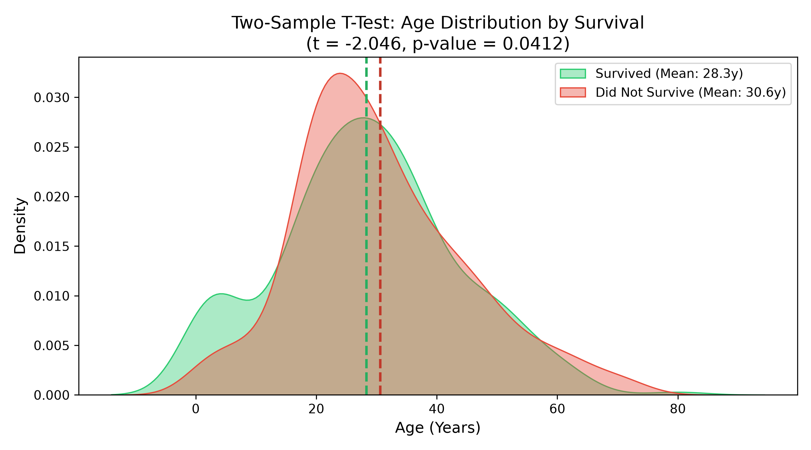
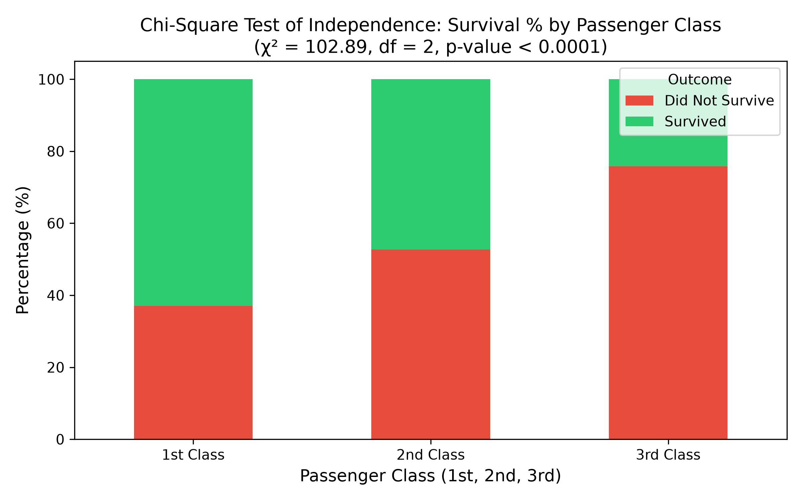
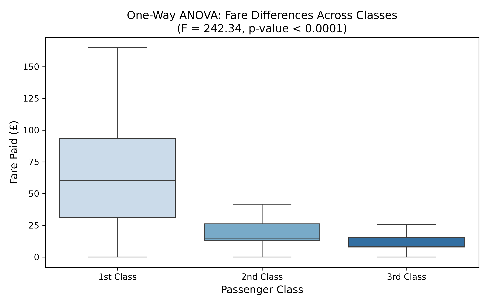

# Statistical Analysis and Hypothesis Testing in Python: Titanic Dataset

## 📌 Project Overview
This repository contains a statistical investigation and hypothesis testing suite evaluating factors influencing survival outcomes in the Titanic dataset. Using Python (`scipy.stats`, `pandas`, `seaborn`, and `statsmodels`), we test three formal research hypotheses using parametric and non-parametric techniques.

---

## 🔬 Formulated Hypotheses & Results

### 1. Two-Sample Welch's T-Test: Age vs. Survival
* **$H_0$:** $\mu_{\text{survived}} = \mu_{\text{not\_survived}}$ (Mean age of survivors equals non-survivors).
* **$H_1$:** $\mu_{\text{survived}} \neq \mu_{\text{not\_survived}}$ (Significant difference in mean age).
* **Result:** $t = -2.046$, $p = 0.0412$ ($\alpha = 0.05$).
* **Conclusion:** Reject $H_0$. Survivors were on average slightly younger (28.34 yrs vs 30.63 yrs), heavily bolstered by prioritization of young children.



---

### 2. Pearson's Chi-Square ($\chi^2$) Test of Independence: Class vs. Survival
* **$H_0$:** Passenger class and survival status are independent.
* **$H_1$:** Passenger class and survival status are statistically associated.
* **Result:** $\chi^2 = 102.89$, $df = 2$, $p = 4.55 \times 10^{-23}$.
* **Conclusion:** Overwhelmingly reject $H_0$. Strong dependence between class tier and survival probability (62.9% in 1st class vs 24.2% in 3rd class).



---

### 3. One-Way ANOVA: Ticket Fare across Passenger Classes
* **$H_0$:** $\mu_{\text{fare, C1}} = \mu_{\text{fare, C2}} = \mu_{\text{fare, C3}}$.
* **$H_1$:** Mean fare differs significantly across at least one class pair.
* **Result:** $F = 242.34$, $p = 1.03 \times 10^{-84}$.
* **Conclusion:** Overwhelmingly reject $H_0$. Significant financial stratification existed between passenger decks.



---

## 🛠️ Execution & Deliverables
```bash
pip install scipy statsmodels pandas seaborn python-docx
python hypothesis_testing.py
```
* Generates `Week3_Report.docx` formatted according to academic/internship requirements.
* Exports all high-resolution charts in `visualizations/`.
